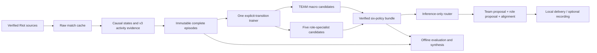

# Six-policy architecture

## Product and boundaries

The deployable unit contains one TEAM macro model and five separately trained role
models: TOP, JUNGLE, MIDDLE, BOTTOM and UTILITY. They share domain contracts, not
optimizer parameters. This first implementation uses independent small networks so
scope-specific support, failures and later replacement remain inspectable.

| Layer | Owns | Must not own |
|---|---|---|
| Common/domain | Observations, actions, evidence, transitions, scopes, compatibility, hashes | Application/research imports |
| Collection/catalogs | Verified identities, transport/retries, immutable raw payloads, exact patches | Model selection |
| Training | Target construction, optimizer, per-scope fitting, candidate comparisons, assembly | UI/game transport |
| Inference | Weights-only loading, contract/integrity checks, batch routing, coordination | Training or research imports |
| Workflow | One orchestration path and atomic latest references | Duplicate optimizers or collectors |
| UI/session | Local delivery, expiry, selected perspective, opt-in measurement | Invented telemetry or victory claims |
| Research | Frozen diagnostics, evidence review, readable reproducible reports | Production serving dependencies |

## Source map

- `common/src/rift_common/actions.py`, `state.py`: shared ordering/scaling and feasibility.
- `behavior.py`, `timeline.py`, `dataset.py`: causal reconstruction, target evidence,
  complete stored transitions and terminal team outcomes.
- `coaching.py`: six policy scopes and conservative symbolic compatibility.
- `production/src/offline_rift/training/trainer.py`: maintained optimizer path.
- `training/targets.py`: Bellman versus observed episode-return targets.
- `training/consistency.py`: supported, shared-feasibility history-omission regularization.
- `training/coach.py`: per-scope comparisons and immutable six-policy assembly.
- `inference/policy.py`: one independently loadable network.
- `inference/coach.py`: six-network composition and schema/integrity checks.
- `inference/advice.py`, `live_client.py`: delivery persistence and observation adaptation.
- `inference/session.py`, `availability.py`: opt-in measured samples or aggregate masks.
- `ui/`: localhost server, view state and static assets.
- `research/src/rift_research`: optional evaluation, diagnostics and report generation.

## Bundle and publication contract

A single policy stores policy.pt, metadata.json, bundle.json and run.json. A coach
stores six child policy directories, aggregate metadata, coach.json and run.json.
The coach manifest binds child manifests, aggregate metadata and completion record.
Children must use the same dataset digest, state/action schema, feature order and
match partitions, and must declare separate fitting and serving scopes.

Coach completion requires independent child reloads and exact aggregate routing
parity. Verification checks the frozen dataset digest, complete match split and saved
serving predictions. Activation records the prior reference before atomically replacing
latest.json. A completed candidate is experimental; activation is not strategic validation.

The runtime factory accepts historical single-policy bundles and six-policy bundles.
Old schemas retain their semantics. Historical source and documents remain checksummed
under the local archive; the current product is never narrowed by an old ADC pilot.

## Coordination contract

TEAM is evaluated on the same causal observation as the selected specialist. Matching
symbolic directions are aligned; distinct explicit destinations are conflicts; other
activities are independent. Missing advice is unresolved. A conflicting role destination
is withheld, without inventing a replacement; recheck after delivery persistence.
Coordination does not blend scores or override a role choice with an unsupported plan. Specialist policies are not
claimed to be trained conditionally on a counterfactual team proposal.

## Scalability and current limits

Independent training jobs and immutable artifacts permit future scheduling per scope
without changing the domain or serving API. CPU batches and inference batches are
bounded; each model is small and the loaded coach is reused between requests. Current
NPZ datasets are loaded into memory. Distributed/out-of-core training and horizontal
serving are not implemented or claimed. Those are later deployment decisions, not
requirements for a speculative framework in the current codebase.

Tests enforce import direction, real optimizer/save/reload behavior, scoped fitting,
terminal discounts, holdout exclusion, corruption detection, routing and offline UI
fixtures. No live-game test is part of the current development phase.
