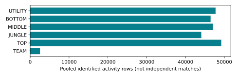

# Offline Rift: six-policy macro coach

Current product synthesis. One team-direction model and separate TOP, JUNGLE, MIDDLE, BOTTOM and UTILITY specialists share causal state/action contracts and terminal team victory as the objective. The ADC-only pilot is historical.

This phase builds and tests the product offline. No active-game test was run. Saved-model correctness and behavior diagnostics do not establish optimal strategy, calibrated victory probabilities or increased win rate.

Architecture: verified raw cache → causal v3 evidence and complete episodes → one maintained trainer → six independent selected networks → integrity-checked inference router → team proposal, role proposal and symbolic alignment/conflict. Production imports no research; inference imports no training orchestration.

Coordination compares the actual proposals. It does not blend scores, silently override the specialist, or claim that the specialist was trained conditional on a hypothetical macro plan.

| Layer | Boundary |
| --- | --- |
| Common | Causal state, evidence, transitions, scopes, compatibility |
| Production training | Optimizer and explicit TD/observed-return targets |
| Production inference | Six verified independent networks and routing |
| Workflow / UI | One orchestration path and optional future delivery |
| Research | Offline diagnostics and reproducible reporting |

# Data, targets and exclusions

The frozen dataset is /home/amine/offlineRift/data/projects/faker/next-actions/datasets/next-actions-4da80e1f73db1287/transitions.npz. Its SHA-256 is 8b6aa5b2e4cd366d56825bd5a126a46b9346b8d44f0a1a99da1356bb948b2846. There are 1258 training, 314 development and 47 reserved matches. Every perspective of a match remains together.

The existing cache contained enough role and macro evidence, including previously downloaded games not used by the earlier study. No extra games were collected merely to increase volume. Reserved IDs were frozen before this comparison; pooled support audits inspected evidence availability, not holdout model performance.

V3 retains representative labels, candidate activities, identification flags and complete stored transitions. Death-only combat and overlapping activity do not identify intent. TEAM targets require three identified matching executed macro options. No coherent direction is unresolved, not a positive continue strategy.

Only identified rows in the requested scope fit its action-specific losses/support counts. Exclusions remain a selection bias. Complete episodes, exact next states, measured elapsed discounts and terminal rewards are preserved without stitching gaps.

| Scope | Identified rows (pooled) | Matches with evidence |
| --- | --- | --- |
| TEAM | 2500 | 1101 |
| TOP | 48597 | 1619 |
| JUNGLE | 43542 | 1619 |
| MIDDLE | 46509 | 1619 |
| BOTTOM | 45900 | 1619 |
| UTILITY | 47133 | 1619 |

# Training and development comparison

Each scope compares two conservative critics with a behavior-imitation baseline. Networks are independent and use one maintained optimizer path. BC is diagnostic only. Selection prefers noncollapsed CQL candidates, then within-scope identified development macro F1, with concentration as a tie breaker.

cql-td uses supported next-action Bellman targets. cql-return variants regress complete observed episode returns with the same conservative penalty. Macro candidates use observed returns because identified macro intervals rarely coincide with terminal frames. This is an explicit conservative return-regression adaptation, not a replication or new theorem for standard CQL.

Terminal team result is used only as supervision. Observed trajectory returns remain confounded by teammates, opponents and hidden state; they are not identified causal alternative-action values. Bounded heads constrain numerical range but do not calibrate values.

F1 measures reconstructed-activity agreement. A higher imitation baseline or concentrated policy must be reported, not reinterpreted as a victory-rate comparison. All candidates, failures and source snapshots are retained in the study directory.

| Scope | Selected critic | Identified F1 | BC F1 | Voluntary top share |
| --- | --- | --- | --- | --- |
| TEAM | cql-return-003 | 0.202 | 0.326 | 30.3% |
| TOP | cql-return-003 | 0.154 | 0.181 | 29.1% |
| JUNGLE | cql-return-003 | 0.146 | 0.197 | 37.2% |
| MIDDLE | cql-return-003 | 0.164 | 0.203 | 30.3% |
| BOTTOM | cql-return-003 | 0.154 | 0.198 | 40.5% |
| UTILITY | cql-return-003 | 0.113 | 0.188 | 80.2% |

# Reserved-match results

This fixed selection was evaluated on 47 reserved match IDs and 12612 measured transitions. These IDs were excluded from optimizer and development selection; repeated players and team dependence remain possible. This is an offline retrospective test.

Identified F1 uses identified activities only. Retention is the fraction receiving advice; action diversity counts predicted classes. Top share includes forced respawn outputs in this table, while the development table separates voluntary concentration. None of these measures is policy win rate.

Macro evidence is much thinner than role evidence. Even coherent executed team activity does not establish deliberate coordination. Sparse targets, action reconstruction ambiguity, hidden positioning/vision and selection bias limit interpretation.

Controlled missing-health and missing-history tests are saved in the evaluation report when requested. Changes after removing evidence can be legitimate. They do not establish the frequency of real live missingness or uncertainty calibration.

Changes after cold-history omission: TEAM 64.6%; TOP 36.4%; JUNGLE 52.9%; MIDDLE 46.5%; BOTTOM 37.1%; UTILITY 12.1%. These include actions made infeasible by lost prerequisites; the JSON report separates that mechanism. Omission-test retention: TEAM 100.0%; TOP 100.0%; JUNGLE 100.0%; MIDDLE 100.0%; BOTTOM 100.0%; UTILITY 100.0%. Retention does not establish reliable advice.

| Scope | Identified F1 | Retention | Top share | Action types |
| --- | --- | --- | --- | --- |
| TEAM | 0.221 | 100.0% | 29.0% | 7 |
| TOP | 0.182 | 100.0% | 26.9% | 11 |
| JUNGLE | 0.159 | 100.0% | 37.1% | 13 |
| MIDDLE | 0.155 | 100.0% | 29.3% | 13 |
| BOTTOM | 0.136 | 100.0% | 39.9% | 11 |
| UTILITY | 0.111 | 100.0% | 72.1% | 7 |

# Engineering, cleanup and next tests

The coach manifest binds six child manifests, aggregate metadata and the completed reload-parity record. Children must agree on data digest, feature ordering/scaling and match partitions, and declare independent fitting/serving scopes. Corruption or incompatible children fail loading.

Final validation recorded 96 passing tests, including 6 synthetic Chromium cases. Tests exercise real small optimizer/save/reload runs, scope isolation, holdout exclusion, terminal discounting, routing, corruption rejection, coordination and synthetic local UI behavior. These are engineering checks, not evidence of strategic benefit.

Superseded ADC-only utilities, dated reports and the old specialized synthesis renderer were checksummed into the local archive. Current documentation is concise; historical raw data, datasets, weights and failed/interrupted reports were not deleted. See research/docs/HISTORY.json for the archive manifest.

Later live acceptance should validate each selected role and the macro view, actual input availability, advice expiry, conflicts and opt-in recording. A predefined prospective comparison with terminal victory and measured adherence is still required before an increased-win-rate claim. No live test was needed or performed for this phase.

Reproduce offline: rift verify --model /home/amine/offlineRift/models/six-policy/20261109/release; rift-research evaluate --new-matches --stress --dataset /home/amine/offlineRift/data/projects/faker/next-actions/datasets/next-actions-4da80e1f73db1287/transitions.npz --bundle /home/amine/offlineRift/models/six-policy/20261109/release --output NEW_DIRECTORY. Current source and contracts: README.md, AGENTS.md, docs/ARCHITECTURE.md, docs/MODELING.md and research/docs/PROTOCOL.md.
